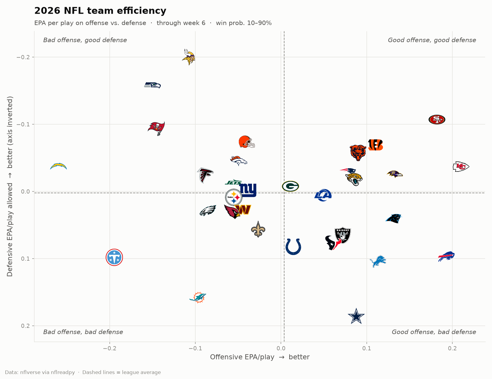
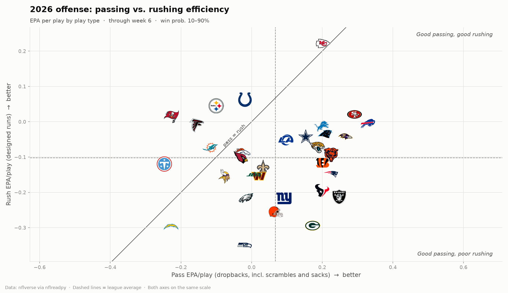
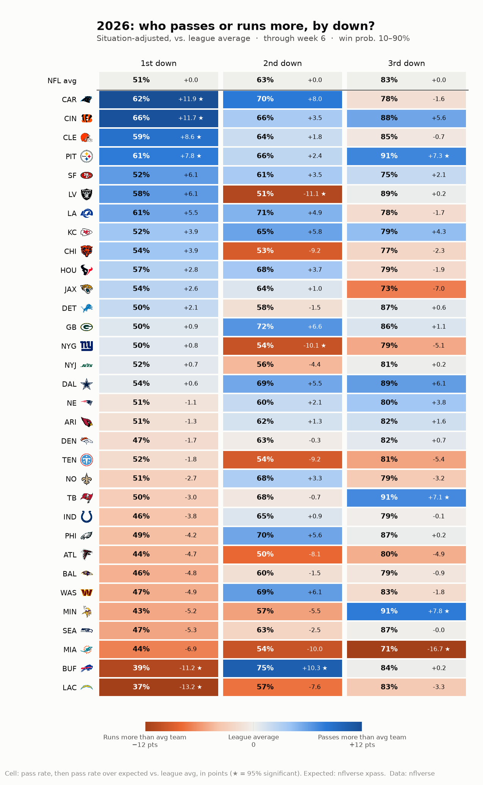
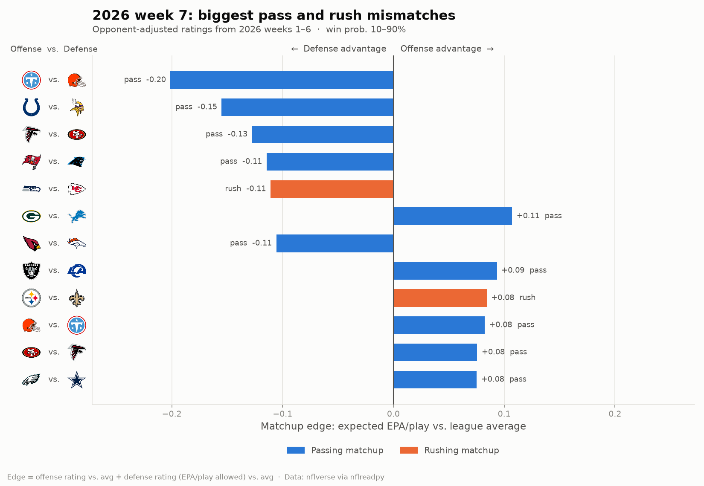
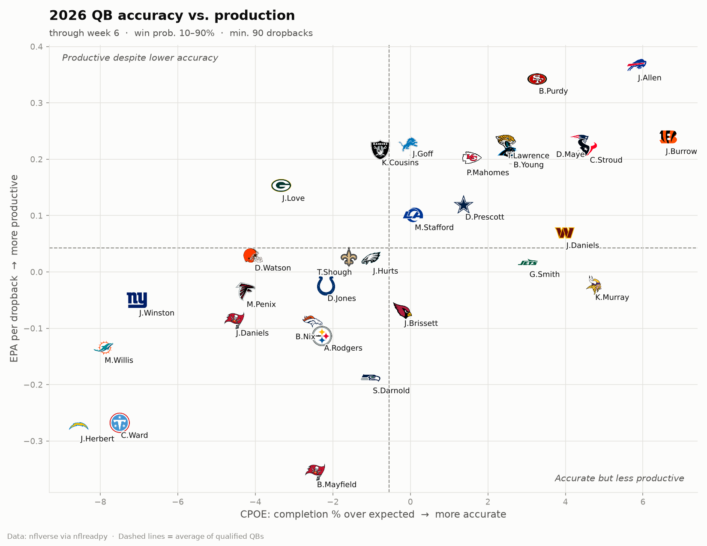

# NFL Analytics

Exploring NFL team and quarterback efficiency with play-by-play data from
[nflverse](https://github.com/nflverse), using Python, pandas and matplotlib.

## Team efficiency (2026 season, through week 6)



Each dot is a team: **offensive EPA per play** (x) vs. **defensive EPA per play allowed** (y,
inverted so up is good). Teams in the top-right are good on both sides of the ball.

- **SF** and **KC** had the best combination of offense and defense.
- **MIN** and **SEA** had the best defenses, despite struggling offenses.
- **DAL** had a top-nine offense undone by the league's worst defense.

## Passing vs. rushing (2026 season, through week 6)



Offensive EPA/play split into dropbacks (x) and designed runs (y), with both axes on the same scale.

- **Passing is more efficient:** the league averaged **+0.067** EPA per dropback vs. **−0.102** per designed run.
  Only **KC, IND, PIT, MIA, ATL, TB and TEN** ran more efficiently than they passed.
- **Passing separates teams:** pass EPA varies more between teams than rush EPA
  (std. dev. 0.16 vs. 0.12). **BUF and SF** passed far better than anyone else.
- **Run-heavy ≠ run-efficient:** pass rate has only a weak correlation with pass efficiency so far (r = 0.18).
  PIT ran better than it passed yet had the 2nd-highest pass rate.
- **Good offenses aren't reliably good at both yet** (r = 0.14 between pass and rush EPA, far weaker than a full
  season typically shows). **BUF, SF and BAL** stand out as above average at both.

## Pass/run tendencies by down (2026 season, through week 6)



Each cell shows how often a team **passed** on that down, followed by its **pass rate over expected**
relative to the league average. Pass rate over expected subtracts nflverse's `xpass`, which accounts for
distance, field position, score and time, so it reflects play-calling rather than game script. It's then
re-centered so the league average is 0 on every down. The color uses the same measure: blue passes more
than a typical team would in the same situations, orange runs more.

- **The most run-leaning 1st-down offenses** were LAC (37% pass, −13.2 points vs. league average) and
  BUF (−11.2). The most pass-leaning were CAR (+11.9), CIN (+11.7), CLE (+8.6) and PIT (+7.8).
- **Tendencies change by down.** A team's 1st-down tendency barely predicts its 2nd-down tendency (r = 0.21).
- **LV and NYG** were the most run-heavy on 2nd down (about −11 and −10 points). **MIA** was the most
  run-heavy on 3rd down by far (−16.7), while **MIN, PIT and TB** were the most pass-heavy (around +7 to +8).
- **Why re-center?** `xpass` is fit on all plays, including garbage time. In the competitive situations
  analyzed here, the whole league runs slightly more than it predicts (about 1 point on 1st down and 3 on
  3rd), so comparing to the league average is fairer than comparing to zero.

## Weekly matchup mismatches



`scripts/matchups.py` rates every team's **pass offense, rush offense, pass defense and rush defense**
(EPA/play, using only games before the target week), then scores each offense-vs-defense matchup:

> **edge** = (offense rating − league avg) + (defense rating − league avg)

A positive edge favors the offense; a negative edge favors the defense. `edge_sd` puts it in standard
deviations, so pass and rush mismatches compare fairly.

**Opponent adjustment.** Ratings come from a ridge regression fit on every play, separately for passing
and rushing: *EPA = league average + offense rating + defense rating*. Solving for all teams at once
credits each unit only for what it did beyond what its opponents usually allow or produce. The ridge
penalty (`--shrinkage`, default 200) works like adding 200 league-average plays to each team, which
pulls small early-season samples toward average. The script also prints the units whose ratings moved
most because of their schedule, and saves every rating, raw and adjusted, to `output/unit_ratings_*.csv`.

```bash
python scripts/matchups.py                          # next week with unplayed games
python scripts/matchups.py --season 2026 --week 8
python scripts/matchups.py --no-adjust              # raw per-play averages
python scripts/matchups.py --prior-weight 0.25      # blend in last season's plays
```

**Does it work?** Backtested on 2025, rating teams on prior weeks only and comparing each edge to
the game's actual EPA/play:

| Ratings | Pass r (wk 3–8) | Pass r (wk 9–18) | Rush r (wk 9–18) | Early pass error |
|---|---:|---:|---:|---:|
| Raw averages | 0.205 | 0.368 | 0.165 | 0.148 |
| Shrinkage only | 0.186 | 0.376 | 0.161 | 0.116 |
| **Opponent-adjusted + shrinkage (default)** | 0.193 | 0.373 | 0.174 | **0.115** |

Most of the gain comes from **shrinkage**. Raw early-season edges overstated real results by about 3×,
and shrinking them cut prediction error by about 22%. Opponent adjustment adds a small improvement on
top, mainly for rushing, though one season is not enough to be confident about a gain that size.
Passing mismatches remain far more predictive than rushing ones.

## Quarterbacks (2026 season, through week 6)



| # | QB | Team | Dropbacks | EPA/db | CPOE | Success % |
|---|---|---|---:|---:|---:|---:|
| 1 | J.Allen | BUF | 179 | +0.367 | +5.8 | 46.9 |
| 2 | B.Purdy | SF | 161 | +0.342 | +3.3 | 54.0 |
| 3 | J.Burrow | CIN | 162 | +0.240 | +6.6 | 51.9 |
| 4 | D.Maye | NE | 173 | +0.236 | +4.4 | 52.0 |
| 5 | T.Lawrence | JAX | 176 | +0.230 | +2.5 | 50.0 |
| 6 | J.Goff | DET | 129 | +0.227 | -0.1 | 48.8 |
| 7 | C.Stroud | HOU | 209 | +0.221 | +4.6 | 51.7 |
| 8 | K.Cousins | LV | 189 | +0.217 | -0.8 | 50.3 |
| 9 | B.Young | CAR | 182 | +0.212 | +2.5 | 45.1 |
| 10 | P.Mahomes | KC | 147 | +0.203 | +1.6 | 50.3 |

Minimum 90 dropbacks (15 per week played). Full table: [`output/qb_stats_2026.csv`](output/qb_stats_2026.csv).
Ranked bar chart: [`figures/qb_epa_ranking_2026.png`](figures/qb_epa_ranking_2026.png).

## Methodology

- **Data:** nflverse play-by-play, loaded with [`nflreadpy`](https://github.com/nflverse/nflreadpy).
- **Plays:** regular-season pass and run plays with an EPA value.
- **Garbage time removed:** only plays where the offense's win probability was 10–90%.
- **EPA (expected points added):** how much a play changed the offense's expected points.
- **QB stats** use dropbacks (passes, sacks, scrambles) and `qb_epa`, which doesn't penalize
  the QB for a receiver's fumble after the catch.
- **CPOE:** completion percentage over expected, based on throw difficulty.
- **Composite:** average of EPA/dropback and CPOE z-scores among qualified QBs.

## Project structure

```
src/nfl_analytics/
  data.py             load and filter play-by-play
  team_efficiency.py  team EPA, pass vs. rush split, and charts
  qb_stats.py         QB stats table and charts
  matchups.py         pass/rush unit ratings and matchup edges
  logos.py            team logos as chart markers (downloaded once, cached)
  style.py            shared chart styling
scripts/make_charts.py  regenerate every season chart and table
scripts/matchups.py     weekly matchup mismatches
notebooks/
  01_team_efficiency.ipynb
  02_qb_stats.ipynb
figures/   saved charts
output/    CSV tables
```

## Getting started

```bash
git clone https://github.com/girsc007/nfl-analytics.git
cd nfl-analytics
python -m venv .venv
source .venv/bin/activate        # Windows: .venv\Scripts\activate
pip install -r requirements.txt

python scripts/make_charts.py                  # 2026 season to date
python scripts/make_charts.py --season 2025    # final 2025 regular season
python scripts/make_charts.py --all-plays      # keep garbage time
jupyter notebook notebooks/
```

## Ideas for next analyses

- Pass vs. rush EPA by down and field position (does running pay off near the goal line?)
- Year-over-year stability of EPA vs. CPOE for QBs
- QB performance on 3rd down and in the red zone
- 4th-down decision-making vs. win-probability recommendations
- Does net EPA/play predict win totals better than point differential?

Data courtesy of the nflverse project (CC-BY 4.0). Team logos are downloaded from ESPN's CDN when charts
are generated and cached in `.cache/logos/` (not committed). They're trademarks of their respective teams.
