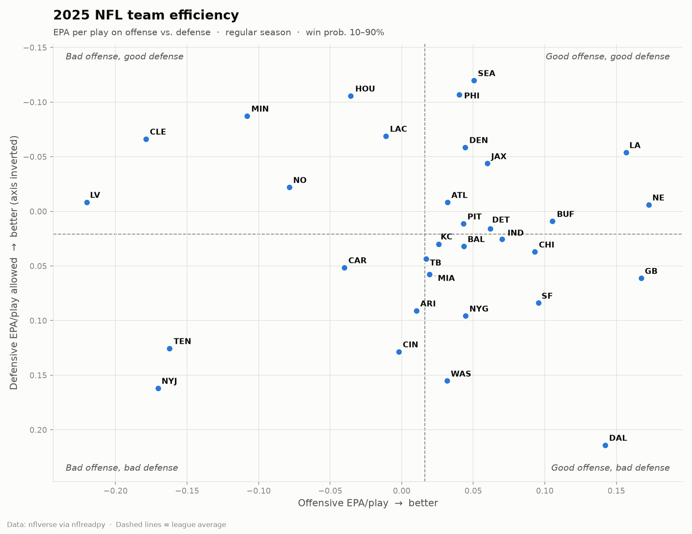
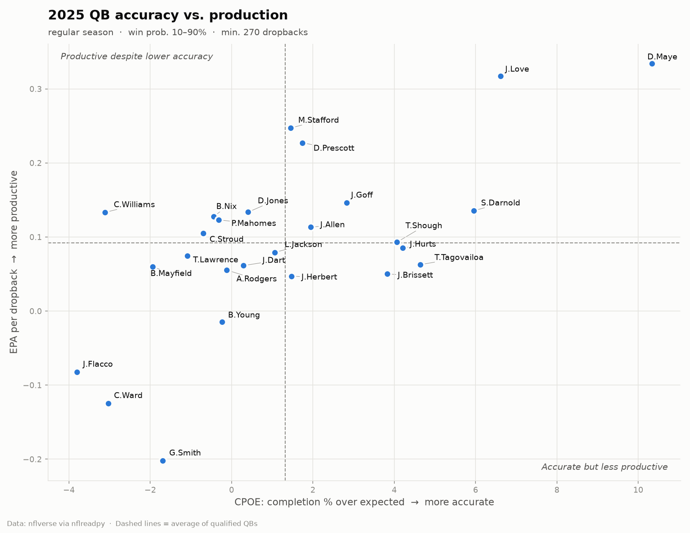

# NFL Analytics

Exploring NFL team and quarterback efficiency with play-by-play data from
[nflverse](https://github.com/nflverse), using Python, pandas and matplotlib.

## Team efficiency (2025 regular season)



Each dot is a team: **offensive EPA per play** (x) vs. **defensive EPA per play allowed** (y,
inverted so up is good). Teams in the top-right are good on both sides of the ball.

- **LA** and **NE** had the best combination of offense and defense.
- **SEA** and **PHI** had the best defenses with average offenses.
- **DAL** had a top-five offense undone by the league's worst defense.

## Quarterbacks (2025 regular season)



| # | QB | Team | Dropbacks | EPA/db | CPOE | Success % |
|---|---|---|---:|---:|---:|---:|
| 1 | D.Maye | NE | 488 | +0.334 | +10.3 | 56.1 |
| 2 | J.Love | GB | 433 | +0.317 | +6.6 | 52.7 |
| 3 | M.Stafford | LA | 514 | +0.247 | +1.4 | 52.7 |
| 4 | D.Prescott | DAL | 516 | +0.227 | +1.7 | 49.0 |
| 5 | J.Goff | DET | 473 | +0.146 | +2.8 | 48.2 |
| 6 | S.Darnold | SEA | 391 | +0.135 | +6.0 | 52.4 |
| 7 | D.Jones | IND | 343 | +0.134 | +0.4 | 48.1 |
| 8 | C.Williams | CHI | 526 | +0.133 | -3.1 | 46.0 |
| 9 | B.Nix | DEN | 555 | +0.128 | -0.4 | 44.9 |
| 10 | P.Mahomes | KC | 497 | +0.123 | -0.3 | 50.3 |

Minimum 270 dropbacks. Full table: [`output/qb_stats_2025.csv`](output/qb_stats_2025.csv).
Ranked bar chart: [`figures/qb_epa_ranking_2025.png`](figures/qb_epa_ranking_2025.png).

## Methodology

- **Data:** nflverse play-by-play, loaded with [`nflreadpy`](https://github.com/nflverse/nflreadpy).
- **Plays:** regular-season pass and run plays with an EPA value.
- **Garbage time removed:** only plays where the offense's win probability was 10–90%.
- **EPA (expected points added):** how much a play changed the offense's expected points.
- **QB stats** use dropbacks (passes, sacks, scrambles) and `qb_epa`, which doesn't penalize
  the QB for a receiver's fumble after the catch.
- **CPOE:** completion percentage over expected, based on throw difficulty.
- **Composite:** average of EPA/dropback and CPOE z-scores among qualified QBs.

## Project structure

```
src/nfl_analytics/
  data.py             load and filter play-by-play
  team_efficiency.py  team EPA table and scatter chart
  qb_stats.py         QB stats table and charts
  style.py            shared chart styling
scripts/make_charts.py  regenerate every chart and table
notebooks/
  01_team_efficiency.ipynb
  02_qb_stats.ipynb
figures/   saved charts
output/    CSV tables
```

## Getting started

```bash
git clone https://github.com/girsc007/nfl-analytics.git
cd nfl-analytics
python -m venv .venv
source .venv/bin/activate        # Windows: .venv\Scripts\activate
pip install -r requirements.txt

python scripts/make_charts.py                  # 2025 season
python scripts/make_charts.py --season 2026    # current season to date
python scripts/make_charts.py --all-plays      # keep garbage time
jupyter notebook notebooks/
```

## Ideas for next analyses

- Pass vs. rush EPA split by team
- Year-over-year stability of EPA vs. CPOE for QBs
- QB performance under pressure, on 3rd down, and in the red zone
- 4th-down decision-making vs. win-probability recommendations
- Does net EPA/play predict win totals better than point differential?

Data courtesy of the nflverse project (CC-BY 4.0).
