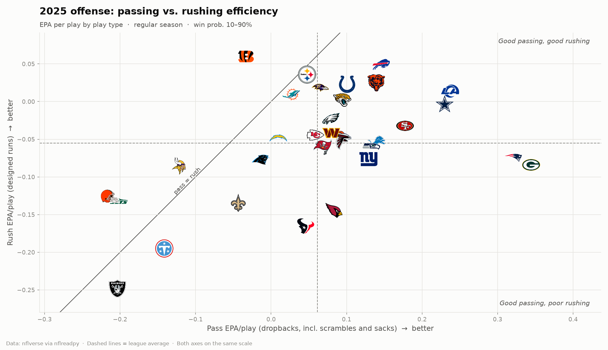
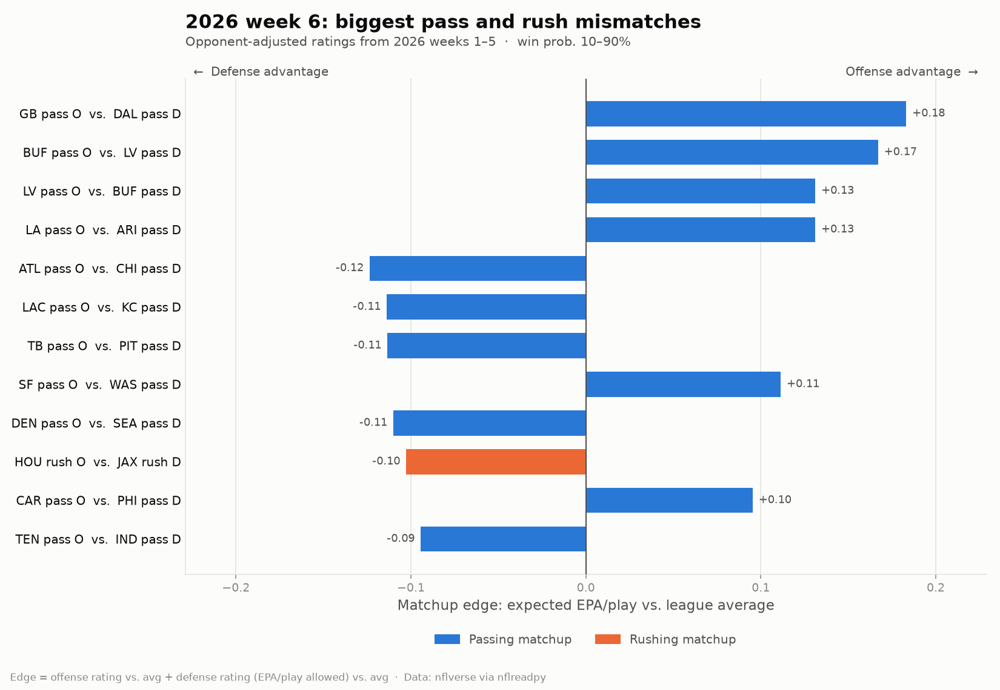
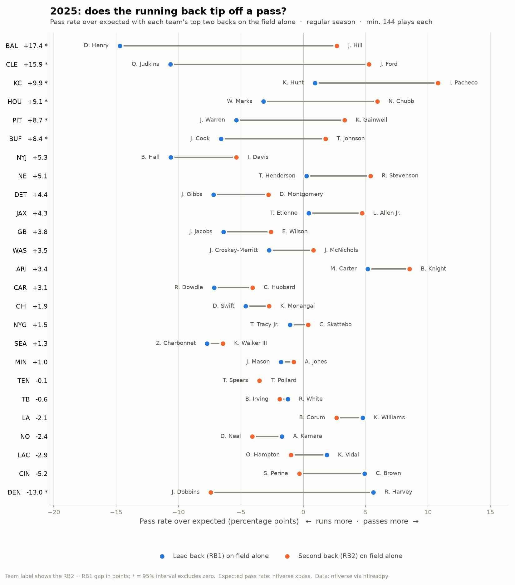

# NFL Analytics

Exploring NFL team and quarterback efficiency with play-by-play data from
[nflverse](https://github.com/nflverse), using Python, pandas and matplotlib.

## Team efficiency (2025 regular season)


Each dot is a team: **offensive EPA per play** (x) vs. **defensive EPA per play allowed** (y,
inverted so up is good). Teams in the top-right are good on both sides of the ball.

- **LA** and **NE** had the best combination of offense and defense.
- **SEA** and **PHI** had the best defenses with average offenses.
- **DAL** had a top-five offense undone by the league's worst defense.

## Passing vs. rushing (2025 regular season)



Offensive EPA/play split into dropbacks (x) and designed runs (y), with both axes on the same scale.

- **Passing is more efficient:** the league averaged **+0.062** EPA per dropback vs. **−0.055** per designed run.
  Only **CIN, MIN, NYJ and CLE** ran more efficiently than they passed.
- **Passing separates teams:** pass EPA varies almost twice as much between teams as rush EPA
  (std. dev. 0.14 vs. 0.07). **GB and NE** passed far better than anyone else.
- **Run-heavy ≠ run-efficient:** pass rate had essentially no correlation with either pass or rush efficiency (r ≈ 0).
  CIN ran better than it passed yet had the 3rd-highest pass rate.
- **Good offenses are usually good at both** (r = 0.49 between pass and rush EPA).
  **BUF, LA and CHI** stand out as above average at both.

## Weekly matchup mismatches



`scripts/matchups.py` rates every team's **pass offense, rush offense, pass defense and rush defense**
(EPA/play, using only games before the target week), then scores each offense-vs-defense matchup:

> **edge** = (offense rating − league avg) + (defense rating − league avg)

A positive edge favors the offense; a negative edge favors the defense. `edge_sd` puts it in standard
deviations, so pass and rush mismatches compare fairly.

**Opponent adjustment.** Ratings come from a ridge regression fit on every play, separately for passing
and rushing: *EPA = league average + offense rating + defense rating*. Solving for all teams at once
credits each unit only for what it did beyond what its opponents usually allow or produce. The ridge
penalty (`--shrinkage`, default 200) works like adding 200 league-average plays to each team, which
pulls small early-season samples toward average. The script also prints the units whose ratings moved
most because of their schedule, and saves every rating, raw and adjusted, to `output/unit_ratings_*.csv`.

```bash
python scripts/matchups.py                          # next week with unplayed games
python scripts/matchups.py --season 2026 --week 8
python scripts/matchups.py --no-adjust              # raw per-play averages
python scripts/matchups.py --prior-weight 0.25      # blend in last season's plays
```

**Does it work?** Backtested on 2025, rating teams on prior weeks only and comparing each edge to
the game's actual EPA/play:

| Ratings | Pass r (wk 3–8) | Pass r (wk 9–18) | Rush r (wk 9–18) | Early pass error |
|---|---:|---:|---:|---:|
| Raw averages | 0.205 | 0.368 | 0.165 | 0.148 |
| Shrinkage only | 0.186 | 0.376 | 0.161 | 0.116 |
| **Opponent-adjusted + shrinkage (default)** | 0.193 | 0.373 | 0.174 | **0.115** |

Most of the gain comes from **shrinkage**. Raw early-season edges overstated real results by about 3×,
and shrinking them cut prediction error by about 22%. Opponent adjustment adds a small improvement on
top, mainly for rushing, though one season is not enough to be confident about a gain that size.
Passing mismatches remain far more predictive than rushing ones.

## Does the running back tip off a pass? (2025 regular season)



For the 25 teams that split snaps between two backs, this compares how often the offense passed
with **only its lead back (RB1)** on the field vs. **only its second back (RB2)**. It uses
**pass rate over expected**, which adjusts for down, distance, field position, score and time
using nflverse's `xpass`. Player-level on-field data comes from nflverse participation data.

- **Situation explains most of the raw gap:** on average, teams passed 9.0 points more often with RB2,
  but 5.8 points of that is because RB2 plays more obvious passing downs. The leftover **3.3 points** is the tell.
- **7 of 25 teams had a significant tell** (about 1 would be expected by chance).
  **BAL** was the most predictable: 80% pass with Justice Hill alone vs. 39% with Derrick Henry,
  **+17 points** after adjusting for situation. **CLE** (Ford vs. Judkins) was close behind at +16.
- **DEN flipped the pattern:** it passed 13 points *less* than expected with its second back, J.K. Dobbins, on the field.
- **SEA, MIN, TEN and TB** were hard to read. Their two backs had nearly identical tendencies.
- Two backs on the field together is rare: **3% of plays**.

Full table: [`output/rb_pass_tendencies_2025.csv`](output/rb_pass_tendencies_2025.csv).
Walkthrough: [`notebooks/03_rb_pass_tendencies.ipynb`](notebooks/03_rb_pass_tendencies.ipynb).

## Quarterbacks (2025 regular season)


| # | QB | Team | Dropbacks | EPA/db | CPOE | Success % |
|---|---|---|---:|---:|---:|---:|
| 1 | D.Maye | NE | 488 | +0.334 | +10.3 | 56.1 |
| 2 | J.Love | GB | 433 | +0.317 | +6.6 | 52.7 |
| 3 | M.Stafford | LA | 514 | +0.247 | +1.4 | 52.7 |
| 4 | D.Prescott | DAL | 516 | +0.227 | +1.7 | 49.0 |
| 5 | J.Goff | DET | 473 | +0.146 | +2.8 | 48.2 |
| 6 | S.Darnold | SEA | 391 | +0.135 | +6.0 | 52.4 |
| 7 | D.Jones | IND | 343 | +0.134 | +0.4 | 48.1 |
| 8 | C.Williams | CHI | 526 | +0.133 | -3.1 | 46.0 |
| 9 | B.Nix | DEN | 555 | +0.128 | -0.4 | 44.9 |
| 10 | P.Mahomes | KC | 497 | +0.123 | -0.3 | 50.3 |

Minimum 270 dropbacks. Full table: [`output/qb_stats_2025.csv`](output/qb_stats_2025.csv).
Ranked bar chart: [`figures/qb_epa_ranking_2025.png`](figures/qb_epa_ranking_2025.png).

## Methodology

- **Data:** nflverse play-by-play, loaded with [`nflreadpy`](https://github.com/nflverse/nflreadpy).
- **Plays:** regular-season pass and run plays with an EPA value.
- **Garbage time removed:** only plays where the offense's win probability was 10–90%.
- **EPA (expected points added):** how much a play changed the offense's expected points.
- **QB stats** use dropbacks (passes, sacks, scrambles) and `qb_epa`, which doesn't penalize
  the QB for a receiver's fumble after the catch.
- **CPOE:** completion percentage over expected, based on throw difficulty.
- **Composite:** average of EPA/dropback and CPOE z-scores among qualified QBs.

## Project structure

```
src/nfl_analytics/
  data.py             load and filter play-by-play
  team_efficiency.py  team EPA, pass vs. rush split, and charts
  qb_stats.py         QB stats table and charts
  rb_tendencies.py    pass tendencies by running back on the field
  matchups.py         pass/rush unit ratings and matchup edges
  style.py            shared chart styling
scripts/make_charts.py  regenerate every season chart and table
scripts/matchups.py     weekly matchup mismatches
notebooks/
  01_team_efficiency.ipynb
  02_qb_stats.ipynb
  03_rb_pass_tendencies.ipynb
figures/   saved charts
output/    CSV tables
```

## Getting started

```bash
git clone https://github.com/girsc007/nfl-analytics.git
cd nfl-analytics
python -m venv .venv
source .venv/bin/activate        # Windows: .venv\Scripts\activate
pip install -r requirements.txt

python scripts/make_charts.py                  # 2025 season
python scripts/make_charts.py --season 2026    # current season to date
python scripts/make_charts.py --all-plays      # keep garbage time
jupyter notebook notebooks/
```

## Ideas for next analyses

- Pass vs. rush EPA by down and distance
- Do defenses exploit RB tells? EPA on RB2's runs vs. his passes
- Year-over-year stability of EPA vs. CPOE for QBs
- QB performance under pressure, on 3rd down, and in the red zone
- 4th-down decision-making vs. win-probability recommendations
- Does net EPA/play predict win totals better than point differential?

Data courtesy of the nflverse project (CC-BY 4.0).
